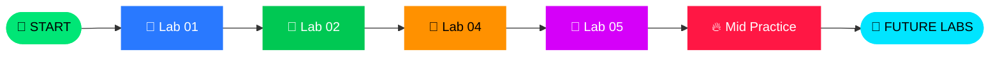
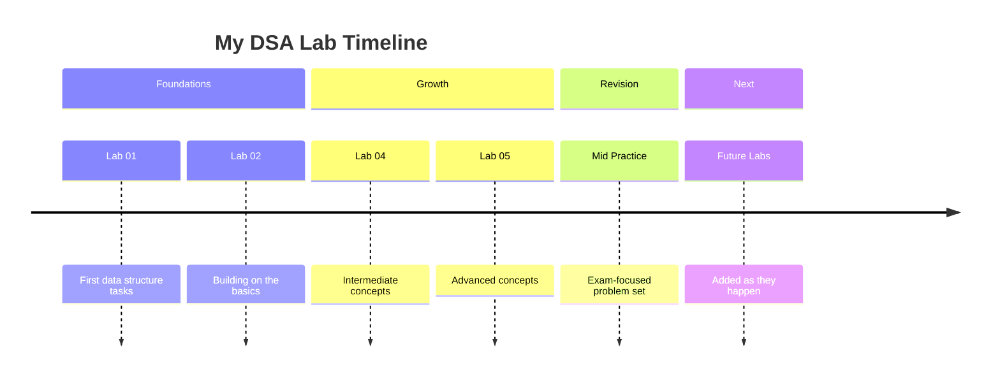
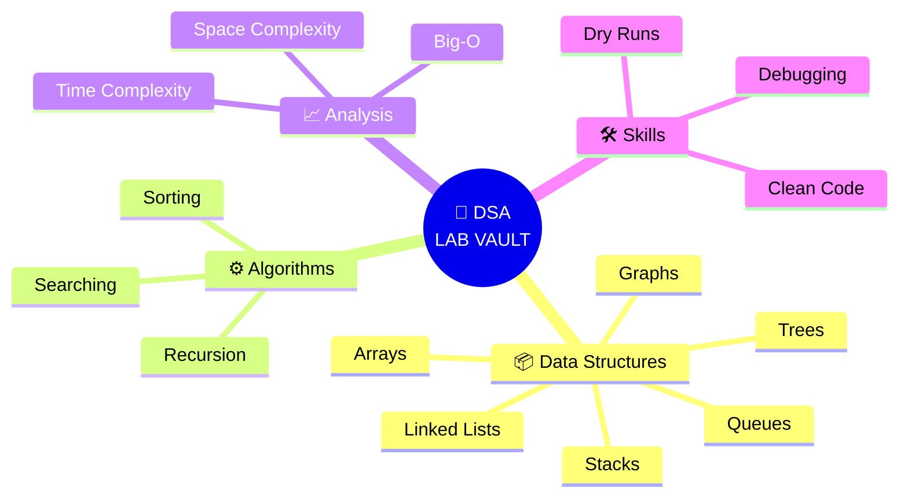

<div align="center">


<a href="https://github.com/SumaiyaAbubakar/DSA-Lab-Vault">
  
</a>

<br/><br/>


<br/><br/>


</div>


<h2 align="center">📑 QUICK MENU</h2>

<div align="center">

[🧠 About](#-about-the-vault) • [🗺️ Map](#️-vault-map) • [🧭 Journey](#-learning-journey) • [📊 Progress](#-progress-tracker) • [🧩 Concepts](#-concepts-mindmap) • [⚡ Big-O](#-big-o-cheat-sheet) • [💻 Snippet](#-featured-snippet) • [▶️ Run](#️-run-any-lab) • [🏆 Stats](#-stats--trophies)

</div>


<h2 align="center">🧠 ABOUT THE VAULT</h2>

<p align="center">
<b>DSA-Lab-Vault</b> is my complete collection of <b>Data Structures & Algorithms</b> lab work.<br/>
Every task is organized, version-controlled, and built to keep growing with each new lab. 🌱
</p>

<div align="center">

| 🎯 Goal | 🛠️ Approach | 🚀 Result |
|:---:|:---:|:---:|
| Master core DSA | Implement everything from scratch | Strong problem-solving base |
| Stay organized | One folder per lab | Fast exam revision |
| Track growth | Commits as a diary | Visible progress over time |

</div>


<h2 align="center">🗺️ VAULT MAP</h2>

```text
📦 DSA-Lab-Vault
 ┃
 ┣ 🔥 DSA LAB MID PRACTICE CODES   → Mid-term revision problems
 ┣ 📘 LAB TASK 01                  → Lab 1 solutions
 ┣ 📗 LAB TASK 02                  → Lab 2 solutions
 ┣ 📙 LAB TASK 04                  → Lab 4 solutions
 ┣ 📕 LAB TASK 05                  → Lab 5 solutions
 ┣ 🙈 .gitignore
 ┗ 📖 README.md                    → You are here ✨
```

<div align="center">

### 🚪 JUMP TO A LAB

[](./DSA%20LAB%20MID%20PRACTICE%20CODES)
[](./LAB%20TASK%2001)
[](./LAB%20TASK%2002)
[](./LAB%20TASK%2004)
[](./LAB%20TASK%2005)

</div>


<h2 align="center">🧭 LEARNING JOURNEY</h2>






<h2 align="center">📊 PROGRESS TRACKER</h2>

<div align="center">

| Lab | Status | Progress |
|:---|:---:|:---|
| 📘 **Lab Task 01** | ✅ Done |  |
| 📗 **Lab Task 02** | ✅ Done |  |
| 📙 **Lab Task 04** | ✅ Done |  |
| 📕 **Lab Task 05** | ✅ Done |  |
| 🔥 **Mid Practice Codes** | ✅ Added |  |
| 🌱 **Upcoming Labs** | ⏳ Soon |  |

</div>


<h2 align="center">🧩 CONCEPTS MINDMAP</h2>



> 📝 *Edit this mindmap to match exactly what your labs cover.*


<h2 align="center">⚡ BIG-O CHEAT SHEET</h2>

<div align="center">

| Algorithm | Best | Average | Worst | Verdict |
|:---|:---:|:---:|:---:|:---:|
| 🔍 Linear Search | O(1) | O(n) | O(n) | 🟡 OK |
| 🎯 Binary Search | O(1) | O(log n) | O(log n) | 🟢 Fast |
| 🫧 Bubble Sort | O(n) | O(n²) | O(n²) | 🔴 Slow |
| 👆 Selection Sort | O(n²) | O(n²) | O(n²) | 🔴 Slow |
| 🃏 Insertion Sort | O(n) | O(n²) | O(n²) | 🟡 OK |
| 🧬 Merge Sort | O(n log n) | O(n log n) | O(n log n) | 🟢 Fast |
| ⚡ Quick Sort | O(n log n) | O(n log n) | O(n²) | 🟢 Fast |

</div>


<h2 align="center">💻 FEATURED SNIPPET</h2>

<p align="center"><i>A taste of the code inside the vault: Binary Search in C++</i></p>

```cpp
#include <iostream>
using namespace std;

// Returns the index of key in a sorted array, or -1 if not found
int binarySearch(int arr[], int size, int key) {
    int low = 0, high = size - 1;

    while (low <= high) {
        int mid = low + (high - low) / 2;   // avoids integer overflow

        if (arr[mid] == key)      return mid;      // 🎯 found it
        else if (arr[mid] < key)  low = mid + 1;   // 👉 search right half
        else                      high = mid - 1;  // 👈 search left half
    }
    return -1;                                     // ❌ not found
}

int main() {
    int data[] = {2, 5, 8, 12, 16, 23, 38, 56};
    int result = binarySearch(data, 8, 23);
    cout << (result != -1 ? "Found at index " + to_string(result) : "Not found") << endl;
    return 0;
}
```


<h2 align="center">▶️ RUN ANY LAB</h2>

```bash
# 1️⃣ Clone the vault
git clone https://github.com/SumaiyaAbubakar/DSA-Lab-Vault.git

# 2️⃣ Open a lab folder
cd "DSA-Lab-Vault/LAB TASK 01"

# 3️⃣ Compile
g++ filename.cpp -o output

# 4️⃣ Run
./output          # Linux / Mac
output.exe        # Windows
```

> 💡 Replace `filename.cpp` with the file you want to run.


<h2 align="center">🛠️ TOOLKIT</h2>

<div align="center">


</div>


<h2 align="center">🏆 STATS & TROPHIES</h2>

<div align="center">


<br/>


<br/>


<br/>


</div>


<h2 align="center">⭐ STAR HISTORY</h2>

<div align="center">

<a href="https://star-history.com/#SumaiyaAbubakar/DSA-Lab-Vault&Date">
  
</a>

</div>


<h2 align="center">🤝 CONNECT & SUPPORT</h2>

<div align="center">

If this vault helps your revision, drop a ⭐ — it keeps me building!

[](https://github.com/SumaiyaAbubakar)
[](https://github.com/SumaiyaAbubakar/DSA-Lab-Vault)

<br/>


<br/><br/>

### 👩‍💻 Crafted with 💜 by **Sumaiya Abubakar**


</div>
